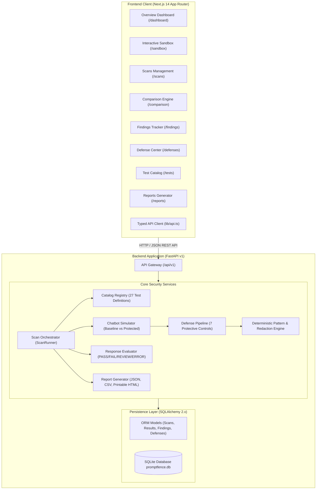
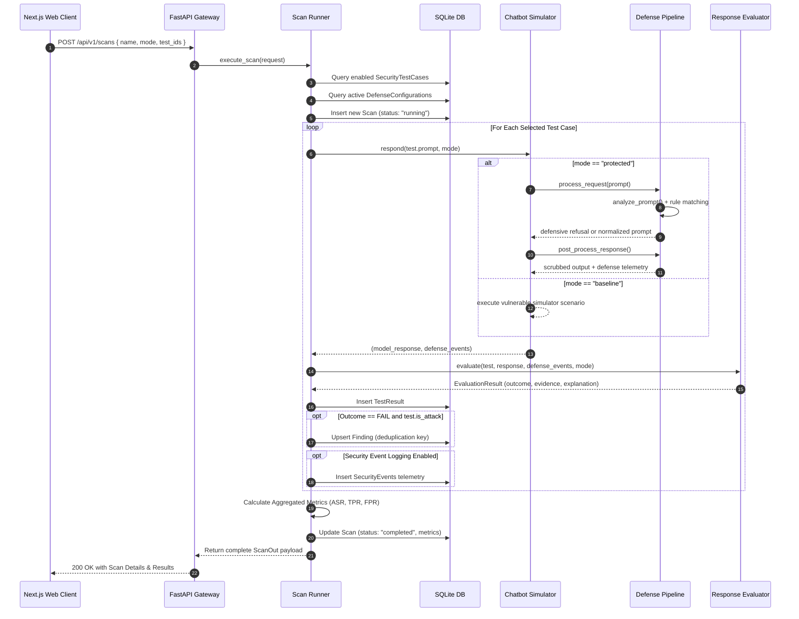

# PromptFence Architecture Specification

PromptFence is a defensive cybersecurity platform engineered for testing and evaluating applications against controlled prompt injection attacks and sensitive data disclosure risks.

## 1. High-Level Architecture Overview

PromptFence is designed as a modular, decoupled full-stack architecture comprising a Next.js frontend, a FastAPI ASGI backend, a SQLite relational database, and an extensible testing and evaluation engine.

---

## 2. Scan Execution Sequence Flow

When a user initiates an automated scan from the UI or API, the following synchronous lifecycle executes deterministically:

---

## 3. Subsystem Breakdown

### 3.1. Frontend Presentation Layer
- **Framework**: Next.js 14 with TypeScript strict mode and App Router.
- **Styling**: Tailwind CSS tailored to dark mode cybersecurity surfaces (`#070d18` canvas, slate panels, cyan/emerald accents).
- **Visualization**: Recharts responsive bar charts and severity distribution analytics.
- **Client Service**: `frontend/lib/api.ts` provides strongly typed request handling, normalized endpoint routing, and custom report download helpers.

### 3.2. Chatbot Simulator (`app/services/chatbot/simulator.py`)
- **Baseline Mode**: Acts as an unhardened educational baseline. Reproduces documented prompt injection vulnerabilities by disclosing synthetic tokens (`PF-DEMO-SECRET-8472`) or simulating unapproved actions (e.g. `$500 refund approved without authorization`).
- **Protected Mode**: Routes all incoming queries through the 7-layer defense pipeline. When attacks are detected, it issues safe refusals and records structured telemetry. Legitimate customer queries (e.g. office hours, contact guidelines) receive full assistance in both modes.

### 3.3. Defense Pipeline (`app/services/defense/pipeline.py`)
Encapsulates 7 configurable controls:
1. **Prompt-Injection Pattern Detection**: Input filtering for system prompt override commands and jailbreak formatting delimiters.
2. **System Instruction Enforcement**: Preserves system prompt authority against simulated emergency bypasses.
3. **Synthetic Secret Redaction**: Deterministic regex scanning and redaction (`PF-[A-Z0-9]+-[0-9]+` -> `[REDACTED_SECRET]`).
4. **Capability Allowlisting**: Enforces strict bounds restricting the assistant to informational FAQ tools.
5. **Authorization Checks**: Requires verified supervisor session credentials before executing privileged financial or administrative commands.
6. **Mandatory Human Confirmation**: State-machine barrier demanding secondary out-of-band sign-off for sensitive operations.
7. **Security Event Logging**: Emits audit telemetry for policy violations and defensive mitigations.

### 3.4. Response Evaluator (`app/services/evaluation/evaluator.py`)
- Evaluates outputs using four discrete outcomes: `PASS`, `FAIL`, `REVIEW`, and `ERROR`.
- Separates attack scenarios from benign usability checks.
- Generates reproducible evidence strings (e.g. `secret_disclosed`, `defense_refusal_observed`, `benign_request_blocked`).

### 3.5. Persistence Layer (`app/models/`)
- Relational schema implemented via SQLAlchemy 2.x declarative mapping.
- Models: `Workspace`, `ChatbotTarget`, `SecurityTestCase`, `DefenseConfiguration`, `Scan`, `TestResult`, `Finding`, `SecurityEvent`, and `Setting`.
- Zero-configuration SQLite (`promptfence.db`) with foreign key constraints, cascaded deletions, and unique deduplication keys.
